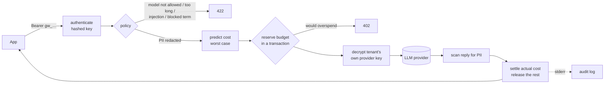

# llm-gateway-guardrails

[](https://github.com/prakash6018/llm-gateway-guardrails/actions/workflows/ci.yml)

A small multi-tenant gateway that sits between your apps and LLM providers. Every request is checked, priced and budgeted **before** any tokens are bought, and every call is metered per tenant.



Zero runtime dependencies: Node 22's built-in `node:sqlite`, `node:crypto`, `node:http` and `fetch`.

## What it does

| Feature | How |
|---|---|
| **Per-tenant policy** | Allowed models, max input tokens, max output tokens, blocked terms, PII mode (`redact` / `block` / `allow`), prompt-injection blocking |
| **PII redaction** | Email, Indian mobile numbers, PAN, Aadhaar (Verhoeff-checked), card numbers (Luhn-checked), API-key-shaped secrets. Runs on the prompt *and* the model's reply |
| **Prompt-injection screen** | Pattern checks on user turns only ("ignore previous instructions", fake `<system>` tags, …). System prompts are the tenant's own and aren't flagged |
| **Cost prediction** | Token estimate × the model's price gives a *worst case* (every allowed output token used) and a *likely* cost. `POST /v1/estimate` returns it without calling a model |
| **Budgets that hold under concurrency** | Reserve the worst case inside `BEGIN IMMEDIATE`, call the model, then replace the reservation with the actual cost. Six parallel requests against a budget that fits two: exactly two run (tested) |
| **Bring your own key** | Each tenant's provider key is sealed with AES-256-GCM. The tenant+provider is bound in as associated data, so a ciphertext copied to another tenant's row fails to decrypt. The master key lives in an env var, never in the database |
| **Gateway keys** | Stored as SHA-256 hashes, compared in constant time, shown once on creation |
| **Usage metering** | Ledger per request: model, input/output tokens, cost. `GET /v1/usage` aggregates the month by model |
| **Failure handling** | Provider errors and timeouts release the reservation and return 502 without leaking provider details |

## Run the demo

Requires Node.js 22.18+ (it runs TypeScript directly).

```bash
node examples/demo.ts
```

```
✔ normal question
    reserved $0.000255 · charged $0.00002 · findings: none
✔ PII is redacted before the model sees it
    reserved $0.000256 · charged $0.000027 · findings: pii.email, pii.card, pii.phone
    model saw: "Customer [EMAIL], phone [PHONE], card [CARD] wants a refund."
✘ prompt injection
    422 policy_violation: prompt looks like an attempt to override instructions
✘ blocked term
    422 policy_violation: prompt contains a blocked term
✘ model not enabled
    422 policy_violation: model gpt-4o-mini is not enabled for this tenant
✘ output cap above policy
    422 policy_violation: max_tokens 4000 exceeds limit 800
✔ large model, worst case reserved
    reserved $0.012036 · charged $0.000126 · findings: none
✘ next one would risk the budget
    402 budget_exceeded: monthly budget $0.0121 would be exceeded: $0.0002 committed, this request may cost up to $0.0120
```

The demo uses a mock model and the illustrative prices in `examples/prices.json`.

```bash
npm test     # 17 tests: policy, PII, pricing, key sealing, budgets, concurrency, HTTP
```

## Run the server

```bash
export GATEWAY_MASTER_KEY=$(node -e "console.log(require('crypto').randomBytes(32).toString('base64'))")
node src/main.ts --add-tenant acme --budget 10        # prints the tenant's gateway key once
node src/main.ts --port 8787
```

```bash
K=gw_...   # from --add-tenant
curl -X PUT localhost:8787/v1/keys/openai -H "authorization: Bearer $K" -d '{"apiKey":"sk-..."}'
curl localhost:8787/v1/estimate -H "authorization: Bearer $K" \
  -d '{"model":"gpt-4o-mini","messages":[{"role":"user","content":"hello"}],"max_tokens":300}'
curl localhost:8787/v1/chat     -H "authorization: Bearer $K" \
  -d '{"model":"gpt-4o-mini","messages":[{"role":"user","content":"hello"}],"max_tokens":300}'
curl localhost:8787/v1/usage    -H "authorization: Bearer $K"
```

### Admin API (for the dashboard)

Set `GATEWAY_ADMIN_TOKEN` to turn on `/admin/*`. It is a separate secret from tenant keys and is meant to live only on the dashboard's server.

| Route | |
|---|---|
| `GET /admin/tenants` | every tenant with budget, month-to-date spend, requests, blocked count, PII redactions |
| `GET /admin/tenants/:id?days=30` | daily series, usage by model, recent events, provider key hints (`…a1b2`, never the key) |
| `PATCH /admin/tenants/:id` | change name, monthly budget or policy (validated) |
| `POST /admin/tenants/:id/estimate` | policy verdict, redacted prompt and cost prediction without calling a model |

Every request, allowed or refused, is written to an `events` table, so the dashboard can show what was blocked and why.

Demo data: `node examples/seed-demo.ts demo.db` pushes about 2,300 requests from three fictional tenants through the real pipeline over a simulated 30 days. See [gateway-dashboard](https://github.com/prakash6018/gateway-dashboard) for the UI.

Any OpenAI-compatible endpoint works as a provider (set `OPENAI_BASE_URL` for Azure, Groq, a local vLLM/Ollama, …). Adding another provider means implementing one method: `complete({ model, messages, maxTokens, apiKey, signal })`.

## Project layout

```
src/policy.ts       model allow-list, limits, injection patterns, PII detectors (Luhn, Verhoeff)
src/tokens.ts       tokenizer-free token estimate
src/pricing.ts      worst-case and likely cost prediction
src/keys.ts         AES-256-GCM key vault, hashed gateway keys
src/store.ts        tenants, sealed keys, usage ledger with reserve/settle (node:sqlite)
src/gateway.ts      the pipeline
src/http.ts         /v1/chat, /v1/estimate, /v1/usage, /v1/keys/:provider
src/admin.ts        /admin/* routes for the dashboard
src/providers/      mock and OpenAI-compatible adapters
examples/           demo script, 30-day demo seeder, sample price table
```

## Limits and next steps

- Regex PII detection catches common formats, not names or free-form addresses; a production setup would add an NER model.
- Injection patterns are a first filter, not a guarantee. Pair them with least-privilege tools on the model side.
- The token estimate is approximate; billing uses the provider's reported usage.
- No streaming yet. Streaming would settle the ledger from the final usage chunk.

## License

MIT
